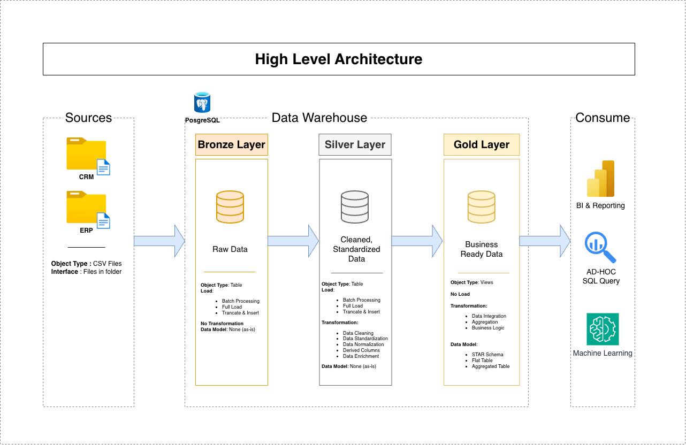
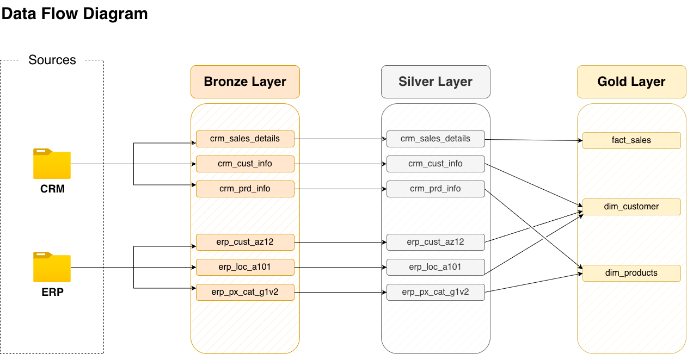
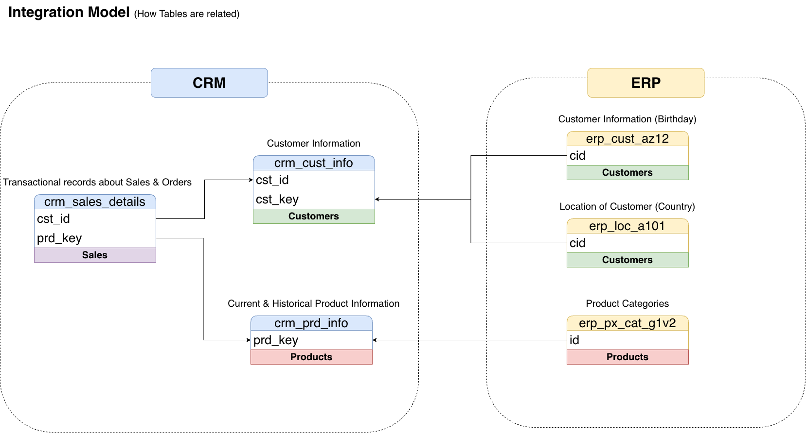
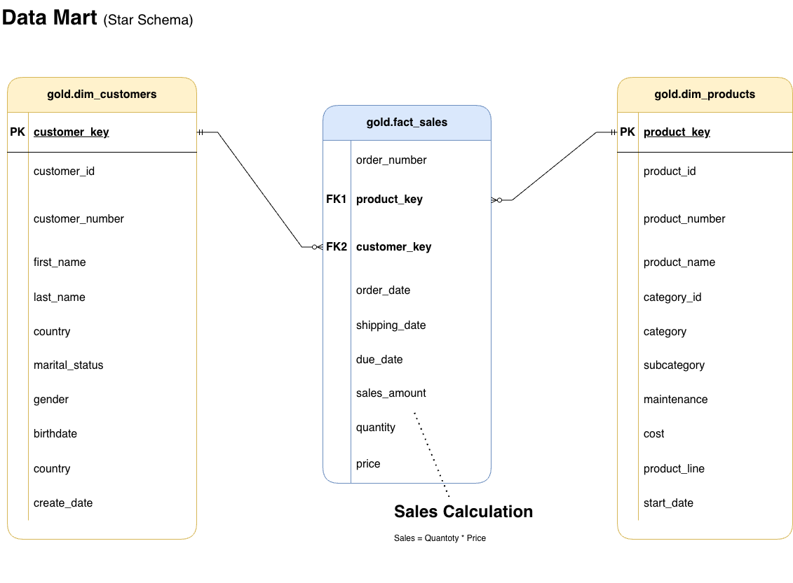

# SQL Data Warehouse — Medallion Architecture

**PostgreSQL · ETL · Star Schema · Docker**

A production-style data warehouse that ingests CRM and ERP CSVs, cleans them in SQL, and serves a star schema for analytics.

Built by **[Fakhruddin Hussain](https://github.com/Fakhruddin-Hussain)** — Data Engineer. I design and operate ETL pipelines for **real estate** and **retail**, from messy source files to models that analysts and BI tools can trust.

[](https://www.postgresql.org/)
[](https://www.docker.com/)
[](#)
[](#architecture)

---

## Why this project

Hiring managers rarely get to see how you think about **layers, quality, and a usable model**. This repo is that walkthrough:

- Load raw CRM and ERP extracts with no transformation
- Standardize, deduplicate, and enrich in Silver
- Publish Gold as `dim_customers`, `dim_products`, and `fact_sales`
- Prove the model with quality checks (unique keys, referential integrity)

It is the same pattern I use in real estate and retail work: **keep source truth, apply business rules in one place, expose a star schema for reporting.**

---

## Architecture

CSV files from CRM and ERP land in PostgreSQL. Each layer has a clear job: Bronze stores as-is data, Silver is cleaned and integrated, Gold is business-ready views for BI, ad-hoc SQL, and ML.



| Layer | Object | Load | What happens |
| --- | --- | --- | --- |
| **Bronze** | Tables | Full load (truncate + `COPY`) | Raw CSV ingest. No transformation. |
| **Silver** | Tables | Full load (truncate + insert) | Cleaning, standardization, derived columns, enrichment. |
| **Gold** | Views | No load | Integration, business logic, star schema. |

---

## Data flow

CRM sales, customers, and products join ERP birthday, country, and category data before they become dimensions and a sales fact.



### Source integration

CRM holds transactions and product history. ERP adds customer demographics, location, and product categories. Gold joins them on business keys (`cst_key` / `cid`, `prd_key` / category `id`).



---

## Gold data mart (star schema)

Analytics query three Gold views:

- **`gold.dim_customers`** — customer, country, gender, birthdate
- **`gold.dim_products`** — current products only (`prd_end_dt IS NULL`), with category and cost
- **`gold.fact_sales`** — orders with surrogate keys, dates, amount, quantity, price



Column-level catalog: [`docs/data_catalog.md`](docs/data_catalog.md)

---

## What the ETL actually does

**Bronze** (`bronze.load_bronze`)

- Truncates each table, then bulk-loads CSVs with `COPY`
- Logs row counts and duration per table

**Silver** (`silver.load_silver`)

- Trims whitespace and fills missing values
- Maps codes to labels (e.g. `M`/`F` → Male/Female, marital status)
- Deduplicates customers (latest `cst_create_date` wins)
- Normalizes dates and product keys; derives category IDs
- Enriches CRM customers with ERP gender, birthdate, and country

**Gold** (`scripts/gold/ddl_gold.sql`)

- Builds surrogate keys with `ROW_NUMBER()`
- Resolves gender from CRM first, ERP as fallback
- Left-joins facts so sales still appear if a dimension is missing

**Quality** (`tests/`)

- Duplicate surrogate keys on dimensions
- Orphan fact rows vs customer and product keys
- Silver completeness, invalid dates, and referential checks

---

## Tech stack

| Area | Choice |
| --- | --- |
| Warehouse | PostgreSQL 16 |
| ETL | PL/pgSQL stored procedures |
| Modeling | Star schema (views on Silver) |
| Runtime | Docker Compose + pgAdmin |
| Sources | CRM and ERP CSV extracts |

---

## Repository layout

```text
data-warehouse-project/
├── datasets/
│   ├── source_crm/          # customer, product, sales CSVs
│   └── source_erp/          # customer extras, location, categories
├── scripts/
│   ├── init_database.sql    # database + bronze/silver/gold schemas
│   ├── bronze/              # DDL + load_bronze
│   ├── silver/              # DDL + load_silver
│   └── gold/                # Gold views (star schema)
├── tests/                   # Silver and Gold quality checks
├── docs/                    # architecture, catalog, naming
├── docker-compose.yml
└── .env.example
```

Naming rules: [`docs/naming_conventions.md`](docs/naming_conventions.md)

---

## Run it locally

**Prerequisites:** Docker Desktop

```bash
git clone https://github.com/Fakhruddin-Hussain/data-warehouse-project.git
cd data-warehouse-project
cp .env.example .env
docker compose up -d
```

Open **pgAdmin** at `http://localhost:8080` if you kept `PGADMIN_PORT` from `.env.example` (Compose defaults to `5050` when the variable is unset).

Register the Postgres server:

| Setting | Value |
| --- | --- |
| Host | `postgres` (from pgAdmin in Docker) or `localhost` (from your machine) |
| Port | `5432` |
| Database / user / password | values in `.env` |

Then run scripts **in this order** in the `datawarehouse` database:

1. `scripts/init_database.sql` — create DB and schemas (skip `CREATE DATABASE` if Compose already created `POSTGRES_DB`)
2. `scripts/bronze/ddl_bronze.sql`
3. `CALL bronze.load_bronze();`
4. `scripts/silver/ddl_silver.sql`
5. `CALL silver.load_silver();`
6. `scripts/gold/ddl_gold.sql`
7. `tests/quality_checks_silver.sql` and `tests/quality_checks_gold.sql`

Example Gold query:

```sql
SELECT
    c.country,
    p.category,
    SUM(f.sales_amount) AS revenue,
    SUM(f.quantity)     AS units
FROM gold.fact_sales f
JOIN gold.dim_customers c ON f.customer_key = c.customer_key
JOIN gold.dim_products  p ON f.product_key  = p.product_key
GROUP BY c.country, p.category
ORDER BY revenue DESC;
```

---

## Skills this project shows

- Layered warehouse design (medallion) instead of a single “cleaned table”
- SQL ETL with logging, truncate-and-load, and bulk ingest
- Cross-system integration (CRM transactions + ERP attributes)
- Dimensional modeling: surrogate keys, current-product filter, fact measures
- Data quality as a first-class step, not an afterthought
- Reproducible local environment with Docker

---

## About me

**Fakhruddin Hussain** — Data Engineer.

I build ETL pipelines for **real estate** and **retail**: source extraction, transformation rules, and models that downstream reporting can use without reverse-engineering the warehouse.

If you are hiring for data engineering, analytics engineering, or warehouse work, I would like to talk.

- LinkedIn: [fakhruddin-hussain](https://www.linkedin.com/in/fakhruddin-hussain/)
- GitHub: [Fakhruddin-Hussain](https://github.com/Fakhruddin-Hussain)
- This repo: [data-warehouse-project](https://github.com/Fakhruddin-Hussain/data-warehouse-project)
